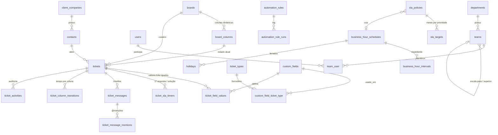

# Helpdesk — Plataforma Omnichannel de Service Desk

Laravel 12 · Filament 3.3 · Livewire 3 · Alpine.js · spatie/laravel-permission · MySQL 8

> **Por que Laravel 12 e não 11?** Toda a linha 11.x está afetada por advisories de segurança
> sem correção (incluindo um *critical* de bypass de autenticação no TokenGuard e um *high* de
> CRLF injection na regra `email`), e a 11.x saiu do suporte de segurança. A 12 é estruturalmente
> idêntica (mesmo esqueleto, mesmas APIs usadas aqui). `composer audit` → sem advisories.

Entregues nesta etapa: **Passo 1** (arquitetura + banco), **Passo 2** (models + services) e
**Passo 3** (Filament: TicketResource, Kanban drag-and-drop, RBAC e telas de configuração).

---

## Instalação

Requisitos: PHP 8.2+ com as extensões **`intl`**, `pdo_mysql`, `mbstring`, `zip`; Composer; MySQL 8.

```bash
composer install
cp .env.example .env          # ajuste DB_* para o seu MySQL
php artisan key:generate
php artisan migrate --seed    # cria tabelas + permissões, perfis, prioridades, quadro e expediente iniciais
php artisan filament:assets   # publica o tema neo-brutalista (resources/css/helpdesk-theme.css)
php artisan helpdesk:create-admin
php artisan serve             # painel em http://localhost:8000/admin
```

Processos em produção:

```bash
php artisan queue:work --queue=sla,automation,notifications,webhooks,default
php artisan schedule:work     # (ou cron: * * * * * php artisan schedule:run)
```

Testes: `php vendor/bin/phpunit` (SQLite em memória — 21 testes cobrindo SLA, Kanban, automação,
round-robin, EAV, RBAC e todas as telas do painel).

---

## Passo 1 — Arquitetura e banco



Decisões que importam:

| Tema | Decisão |
|---|---|
| **Kanban dinâmico** | `board_columns` com nome/cor livres, mas `category` semântica (`new/open/pending/resolved/closed`) para métricas consistentes, `sla_behavior` (`run/pause/stop`) e `wip_limit`. |
| **EAV** | `ticket_field_values` com **colunas tipadas** (`value_string`, `value_number`, `value_datetime`…) e índices `(custom_field_id, valor)` — filtra e agrega de verdade no MySQL, ao contrário de JSON puro. |
| **SLA** | Timer guarda `elapsed_seconds` + `segment_started_at` e **projeta** `due_at`/`warning_due_at`. A varredura minuto a minuto é uma consulta indexada `(status, due_at)`, sem recalcular todos os tickets. |
| **Horário útil** | `BusinessTimeCalculator` soma/subtrai segundos apenas dentro dos intervalos do calendário, no fuso do calendário, pulando feriados (fixos e recorrentes). |
| **Gargalos** | `ticket_column_transitions` registra entrada/saída/duração em cada coluna — base do widget de gargalos (Passo 6). |
| **Concorrência** | Numeração por `ticket_sequences` + `FOR UPDATE`; distribuição trava a linha da equipe; varredura de SLA usa `UPDATE` condicional (idempotente com vários workers). |

## Passo 2 — Domínio

```
app/
├── Services/
│   ├── Tickets/TicketService.php        ← ÚNICO ponto de escrita (Filament, Kanban, API, automações)
│   ├── Sla/SlaCalculationService.php    ← timers, pausa/retomada, reabertura, recálculo, varredura
│   ├── Sla/BusinessTimeCalculator.php   ← aritmética de horário útil + feriados
│   ├── Sla/SlaPolicyResolver.php        ← política mais específica (cliente > tipo > depto)
│   ├── Assignment/AssignmentService.php ← round-robin ponderado por carga/capacidade
│   ├── CustomFields/CustomFieldService.php ← gera componentes Filament + regras + persistência EAV
│   ├── Kanban/BoardService.php          ← sincroniza colunas (bloqueia remover coluna com tickets)
│   └── Automation/                      ← motor QUANDO/SE/ENTÃO + 11 ações plugáveis
├── Repositories/{Contracts,Eloquent}/   ← Ticket, SlaTimer, AgentWorkload
├── Events/  (ShouldDispatchAfterCommit) ← TicketCreated/Moved/Assigned/…, SlaWarningReached, SlaBreached
├── Listeners/TriggerAutomationRules     ← fila "automation"
├── Jobs/ScanSlaTimers, DispatchOutgoingWebhook (HMAC + backoff)
└── Policies/                            ← TicketPolicy + políticas por permissão
```

Exemplo do requisito: *mover para "Em Análise" → notificar; mover para "Aguardando Cliente" → pausar SLA.*
O segundo vem do `sla_behavior = pause` da coluna; o primeiro é uma regra criada no painel:
evento `ticket.moved`, condição `Coluna (destino) = Em Análise`, ação `Notificar responsável`.

## Passo 3 — Painel (Filament)

- **Kanban** (`/admin/kanban`): drag-and-drop (Sortable.js do Filament), filtros por agente/equipe/prioridade/tipo/SLA,
  WIP por coluna, contador de SLA ao vivo no card (a cor muda de verde → amarelo → laranja → vermelho; só "anda" dentro do expediente),
  gestão de colunas inline.
- **Tickets**: formulário com campos dinâmicos por tipo, tabela com coluna de SLA, filtros, ações em massa,
  página de detalhe com timeline (respostas públicas × notas internas com `@menções`), auditoria.
- **RBAC**: perfis com matriz de 32 permissões granulares (`config/helpdesk.php` → `php artisan helpdesk:sync-permissions`),
  usuários, equipes N1/N2/N3 com capacidade, liderança e carga atual, departamentos.
- **Configuração**: quadros, tipos de ticket + formulário, campos customizados, prioridades (com peso), SLAs, expediente/feriados,
  construtor visual de automações com log de execuções.

Zero hardcode: dados de negócio vivem no banco; o que é técnico/ajustável está em `config/helpdesk.php` com override por `.env`.

## Próximos passos (escopo restante)

4. WhatsApp Cloud API (webhook + envio enfileirado), chat interno via Reverb, Google Calendar/Outlook, chamadas WebRTC (Daily.co).
5. API REST Sanctum + webhook bidirecional do Jira (o campo `tickets.jira_issue_key` e o canal `jira` já existem).
6. Widgets (TMA, TME, CSAT, violações, funil, gargalos por coluna) e construtor de dashboards arrastável.
